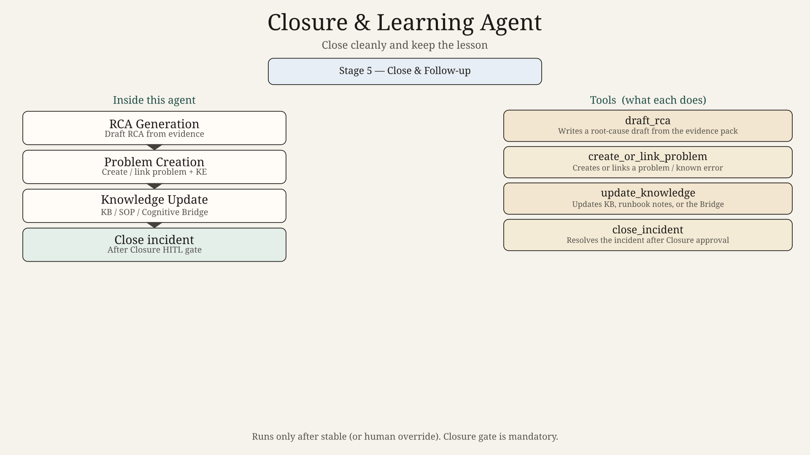
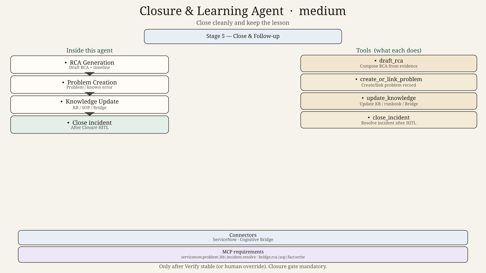
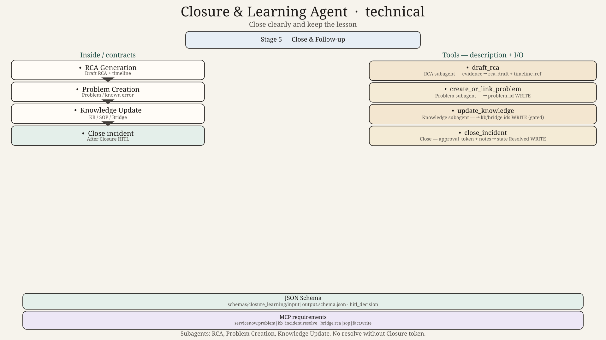

# Closure & Learning Agent — Design

## Role
Close the incident cleanly: resolution notes, RCA draft, problem/known-error link, and knowledge updates.

## Subagents
| Subagent | Job |
|----------|-----|
| RCA Generation | Draft RCA from evidence timeline |
| Problem Creation | Create or link problem / known error |
| Knowledge Update | Update KB, SOP notes, Cognitive Bridge |

## Parent tools
`draft_rca`, `create_or_link_problem`, `update_knowledge`, `close_incident`

## HITL
Closure gate is mandatory. RCA review is human.

## Hard technical contracts

| Contract | Path |
|----------|------|
| Input payload | [`../../schemas/closure_learning/input.schema.json`](../../schemas/closure_learning/input.schema.json) |
| Output payload | [`../../schemas/closure_learning/output.schema.json`](../../schemas/closure_learning/output.schema.json) |
| Invoke/result wrappers | [`../../schemas/shared/`](../../schemas/shared/) |
| Ladder | 0=`diagram.png` → 50=`diagram_medium.png` → 100=`diagram_technical.png` + schemas |
