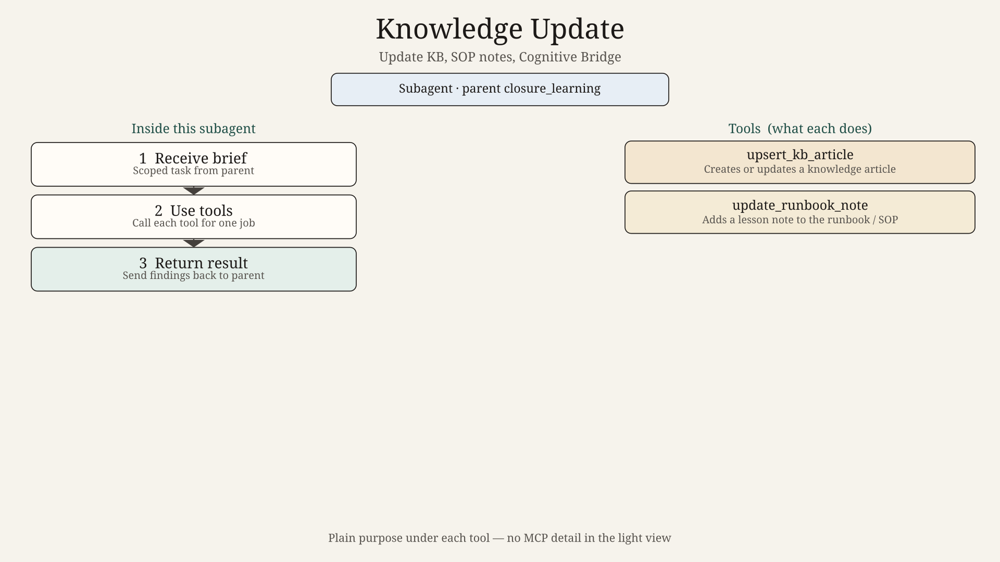
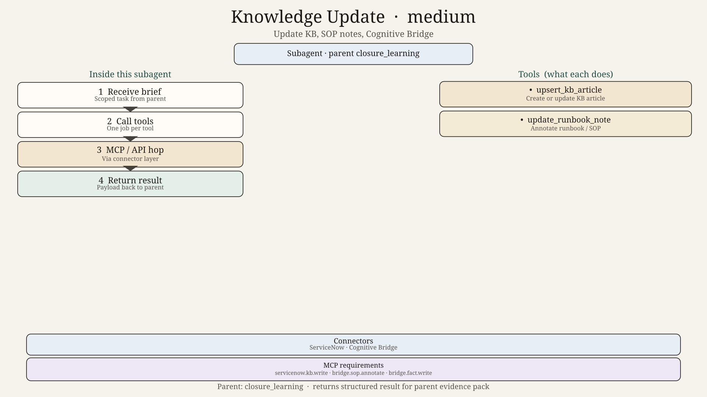
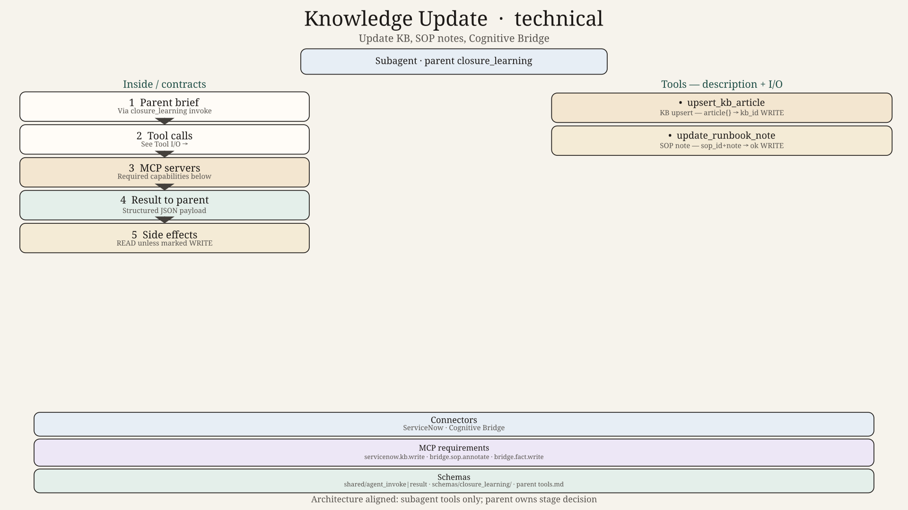

# Knowledge Update Agent — Design

## Role
Update KB articles, runbook notes, and Cognitive Bridge entries.

## Parent
Closure & Learning Agent

## Tools
- `upsert_kb_article`
- `update_runbook_note`
