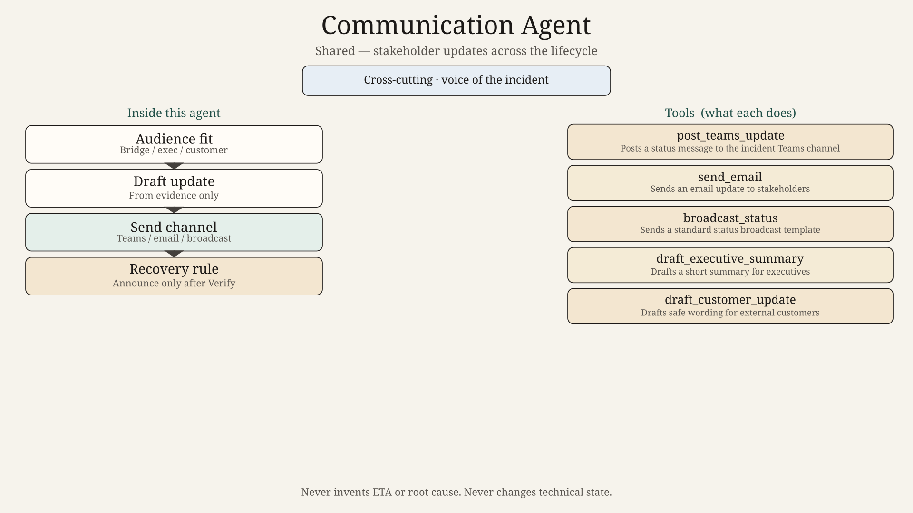
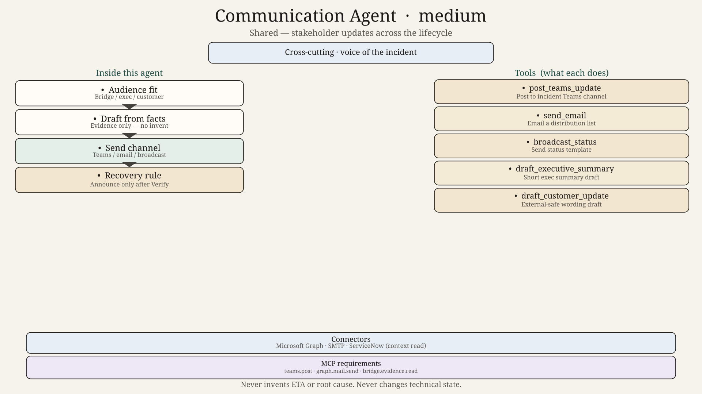
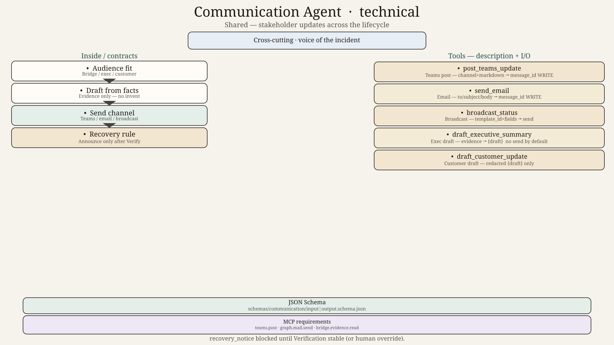

# Communication Agent — Design

## Role
Shared agent. Stakeholder updates across the lifecycle: Teams, email, status broadcasts, executive summaries. Does not change technical state.

## Tools
`post_teams_update`, `send_email`, `broadcast_status`, `draft_executive_summary`, `draft_customer_update`

## Hard technical contracts

| Contract | Path |
|----------|------|
| Input payload | [`../../schemas/communication/input.schema.json`](../../schemas/communication/input.schema.json) |
| Output payload | [`../../schemas/communication/output.schema.json`](../../schemas/communication/output.schema.json) |
| Invoke/result wrappers | [`../../schemas/shared/`](../../schemas/shared/) |
| Ladder | 0=`diagram.png` → 50=`diagram_medium.png` → 100=`diagram_technical.png` + schemas |
