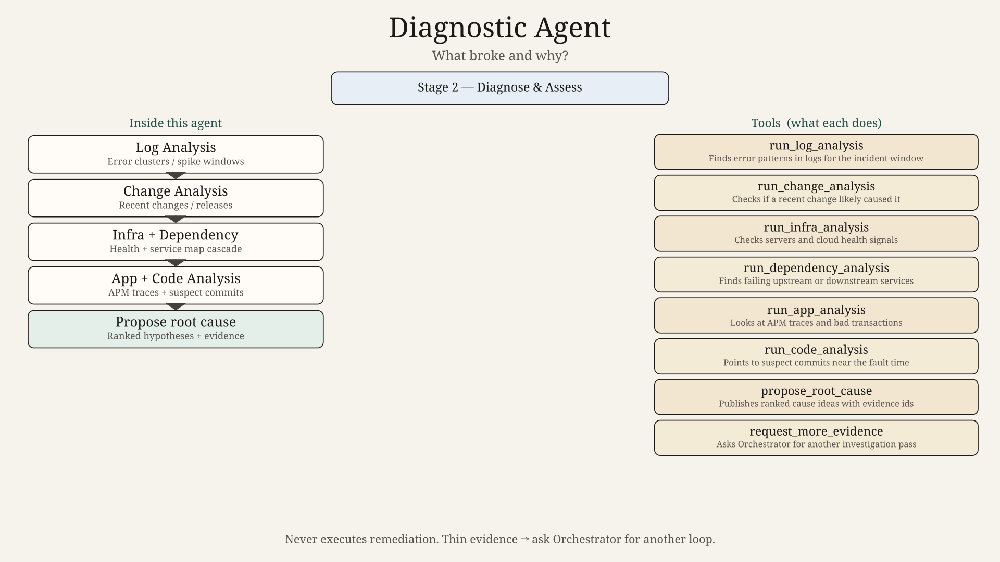
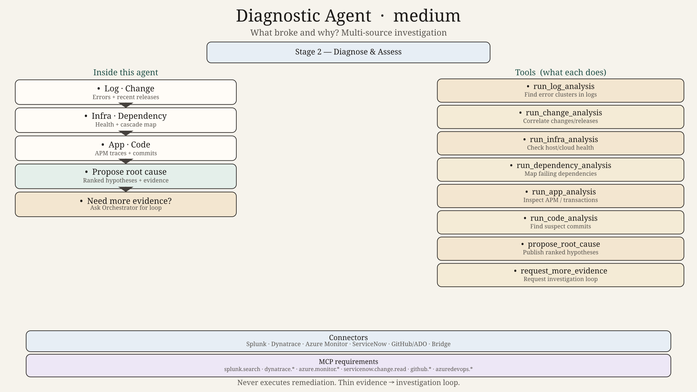
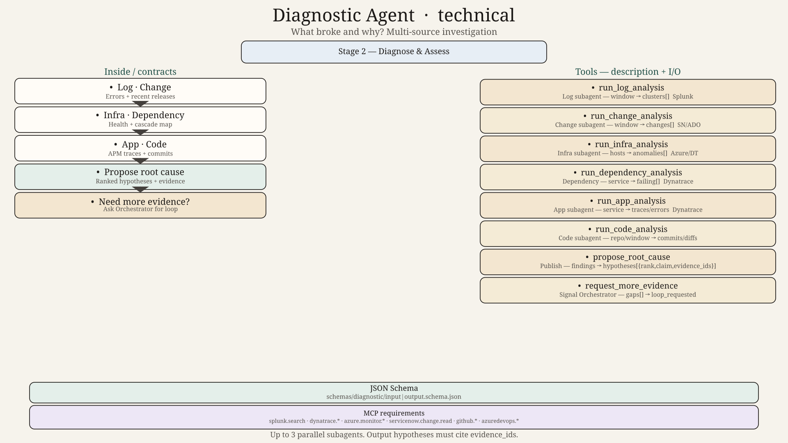

# Diagnostic Agent — Design

## Role
Find the likely root cause using multi-source technical investigation. Recommend what to analyse next. Do not execute fixes.

## Subagents
| Subagent | Job |
|----------|-----|
| Log Analysis | Error clusters and spike windows |
| Change Analysis | Recent changes / releases correlation |
| Infrastructure Analysis | Compute, network, storage health |
| Dependency Analysis | Upstream / downstream failures |
| Application Analysis | APM traces and business transactions |
| Code Analysis | Suspect commits / deployments |

## Parent tools
`run_log_analysis`, `run_change_analysis`, `run_infra_analysis`, `run_dependency_analysis`, `run_app_analysis`, `run_code_analysis`, `propose_root_cause`, `request_more_evidence`

## HITL
None directly — Orchestrator may open an investigation loop or ask humans for expert input.

## Hard technical contracts

| Contract | Path |
|----------|------|
| Input payload | [`../../schemas/diagnostic/input.schema.json`](../../schemas/diagnostic/input.schema.json) |
| Output payload | [`../../schemas/diagnostic/output.schema.json`](../../schemas/diagnostic/output.schema.json) |
| Invoke/result wrappers | [`../../schemas/shared/`](../../schemas/shared/) |
| Ladder | 0=`diagram.png` → 50=`diagram_medium.png` → 100=`diagram_technical.png` + schemas |
