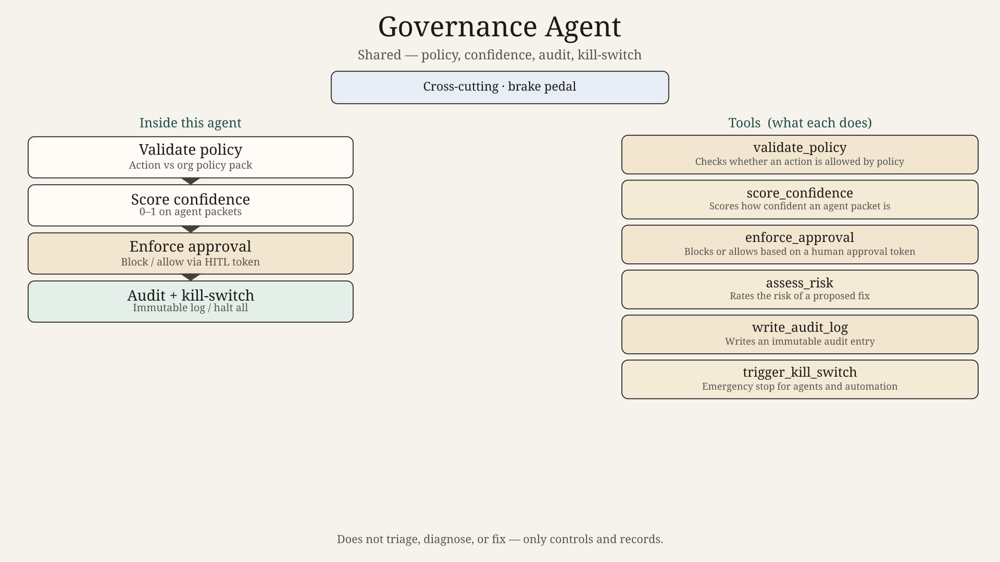
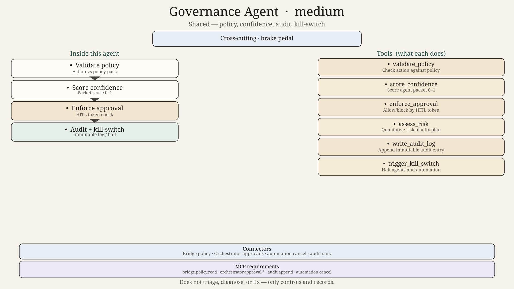
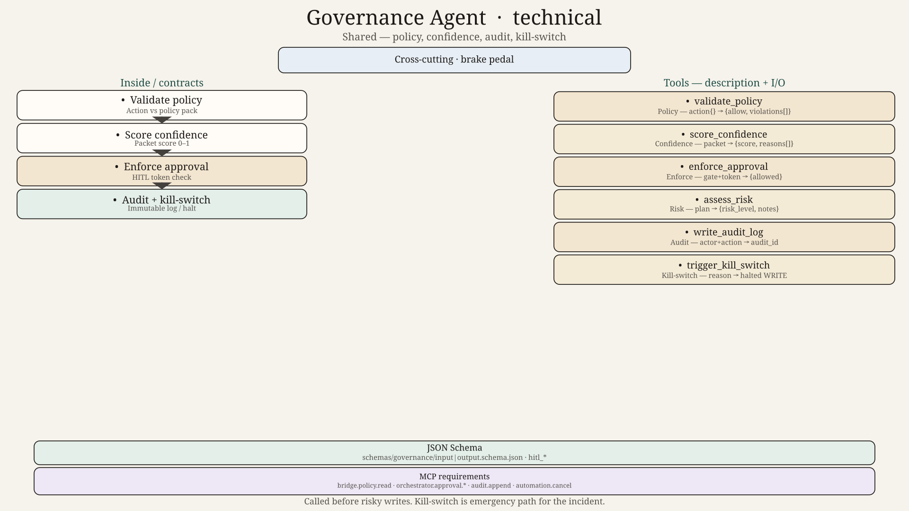

# Governance Agent — Design

## Role
Shared agent. Policy validation, confidence scoring, approval enforcement, audit logging, risk assessment, emergency kill-switch.

## Tools
`validate_policy`, `score_confidence`, `write_audit_log`, `enforce_approval`, `assess_risk`, `trigger_kill_switch`

## Hard technical contracts

| Contract | Path |
|----------|------|
| Input payload | [`../../schemas/governance/input.schema.json`](../../schemas/governance/input.schema.json) |
| Output payload | [`../../schemas/governance/output.schema.json`](../../schemas/governance/output.schema.json) |
| Invoke/result wrappers | [`../../schemas/shared/`](../../schemas/shared/) |
| Ladder | 0=`diagram.png` → 50=`diagram_medium.png` → 100=`diagram_technical.png` + schemas |
