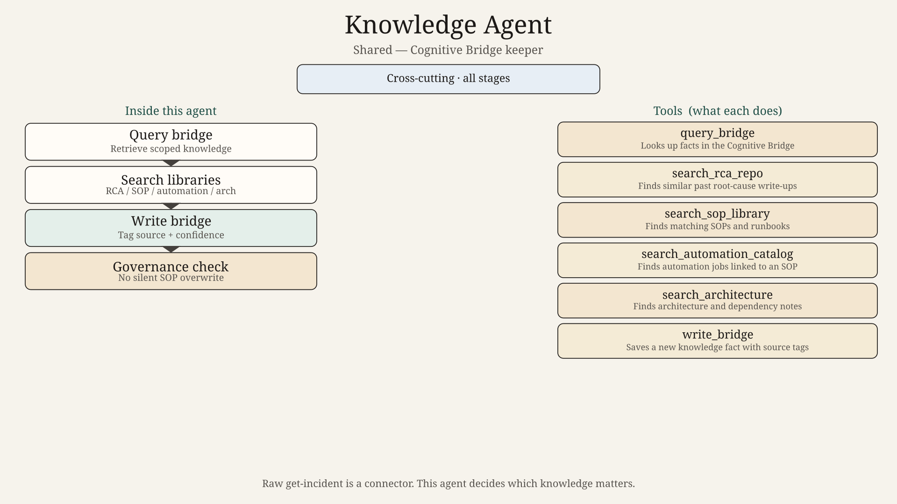
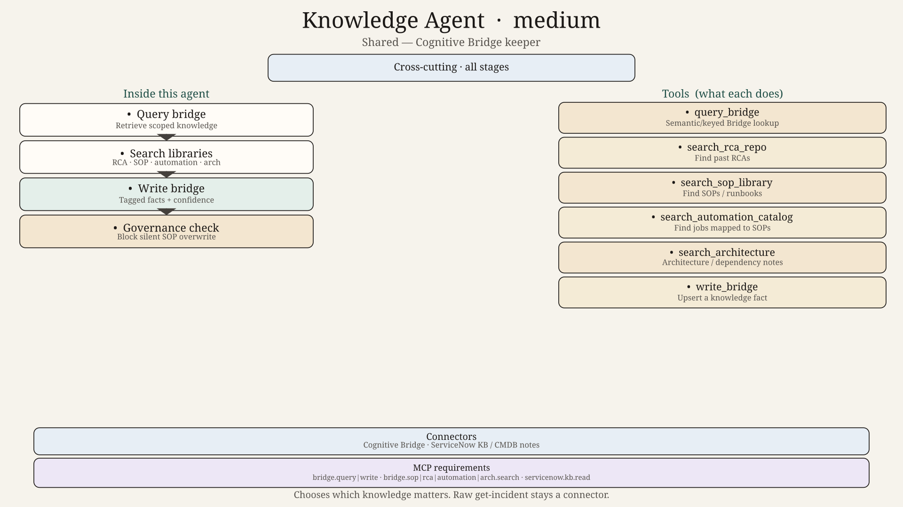
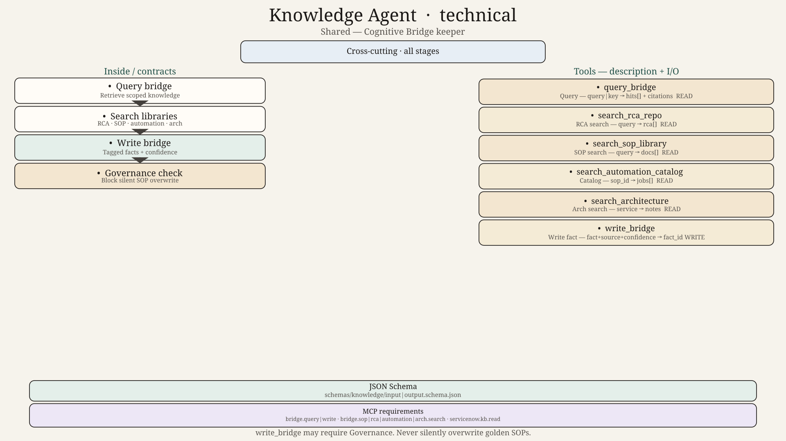

# Knowledge Agent — Design

## Role
Shared agent. Own the Cognitive Bridge: incident history, RCA repo, SOPs, architecture facts, automation catalogue. Other agents query through you instead of inventing memory.

## Tools
`query_bridge`, `write_bridge`, `search_rca_repo`, `search_automation_catalog`, `search_sop_library`, `search_architecture`

## Not an agent for
Raw “get incident by number” — that is the ServiceNow connector. You reason over *which* knowledge matters and keep it consistent.

## Hard technical contracts

| Contract | Path |
|----------|------|
| Input payload | [`../../schemas/knowledge/input.schema.json`](../../schemas/knowledge/input.schema.json) |
| Output payload | [`../../schemas/knowledge/output.schema.json`](../../schemas/knowledge/output.schema.json) |
| Invoke/result wrappers | [`../../schemas/shared/`](../../schemas/shared/) |
| Ladder | 0=`diagram.png` → 50=`diagram_medium.png` → 100=`diagram_technical.png` + schemas |
