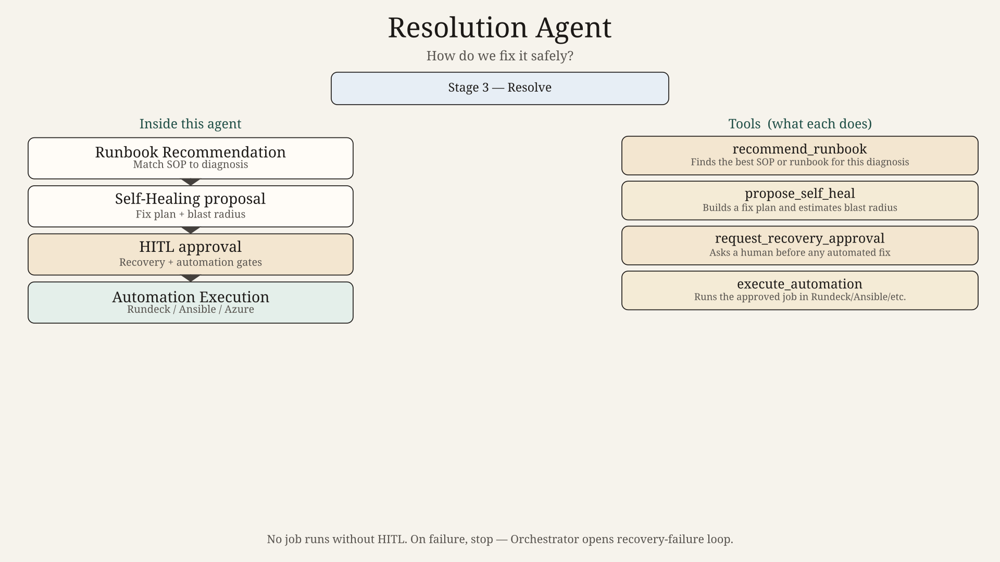
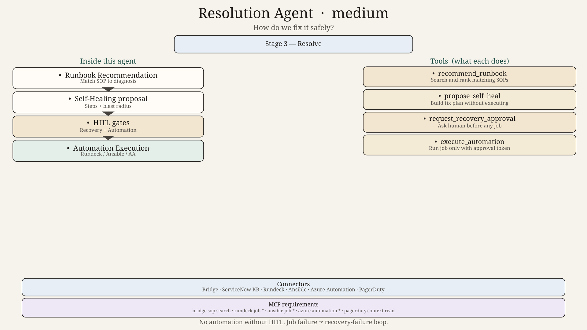
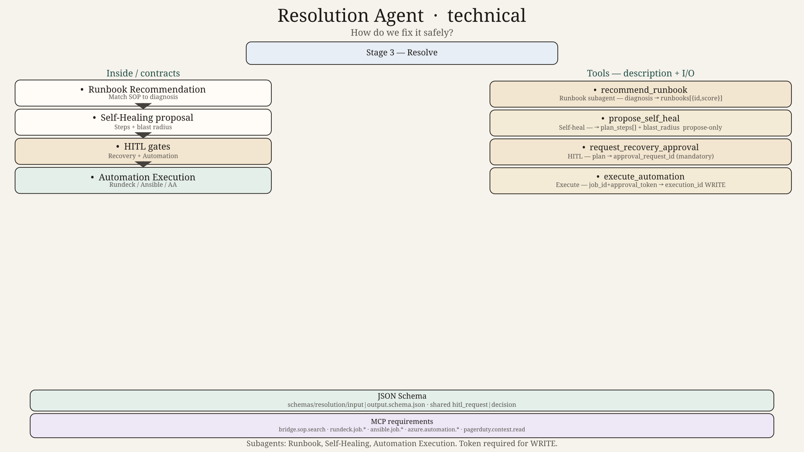

# Resolution Agent — Design

## Role
Recommend a recovery approach and, only after HITL approval, execute automation safely.

## Subagents
| Subagent | Job |
|----------|-----|
| Runbook Recommendation | Match SOP / runbook to the diagnosis |
| Self-Healing | Propose automated fix steps and blast radius |
| Automation Execution | Run approved Rundeck / Ansible / Azure Automation jobs |

## Parent tools
`recommend_runbook`, `propose_self_heal`, `execute_automation`, `request_recovery_approval`

## HITL
Recovery Approach and Automation Execution gates are mandatory before any job runs.

## Hard technical contracts

| Contract | Path |
|----------|------|
| Input payload | [`../../schemas/resolution/input.schema.json`](../../schemas/resolution/input.schema.json) |
| Output payload | [`../../schemas/resolution/output.schema.json`](../../schemas/resolution/output.schema.json) |
| Invoke/result wrappers | [`../../schemas/shared/`](../../schemas/shared/) |
| Ladder | 0=`diagram.png` → 50=`diagram_medium.png` → 100=`diagram_technical.png` + schemas |
