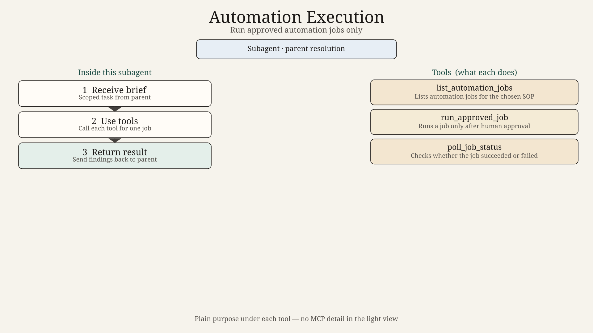
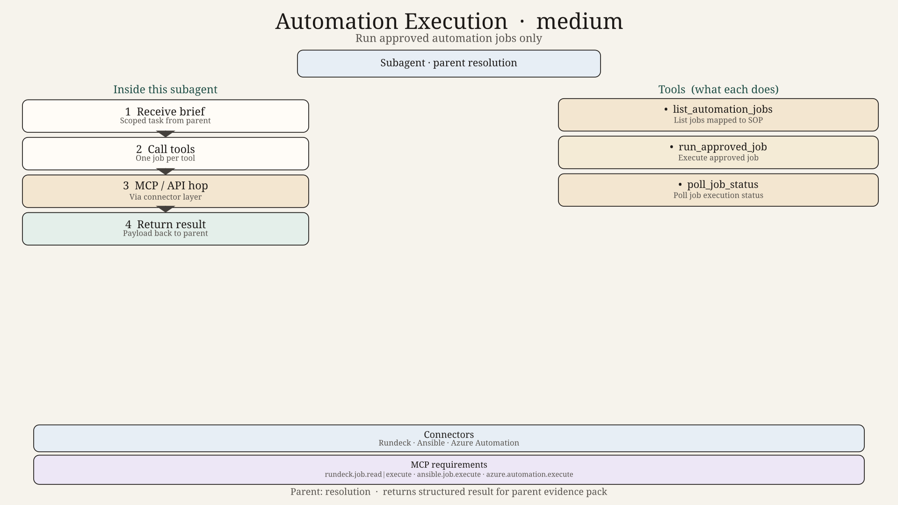
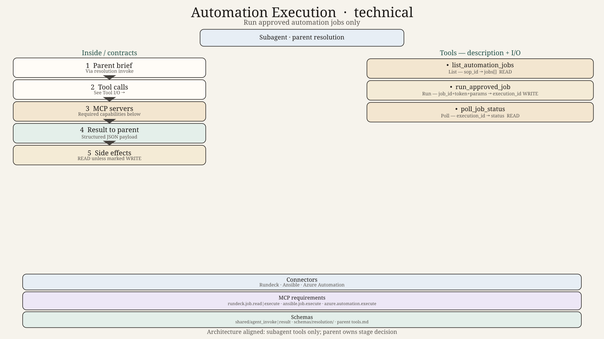

# Automation Execution Agent — Design

## Role
Execute only an approved automation job and report status.

## Parent
Resolution Agent

## Tools
- `list_automation_jobs`
- `run_approved_job`
- `poll_job_status`
