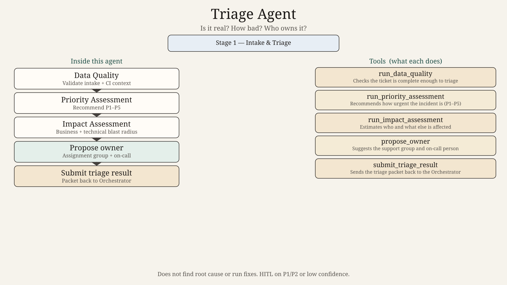
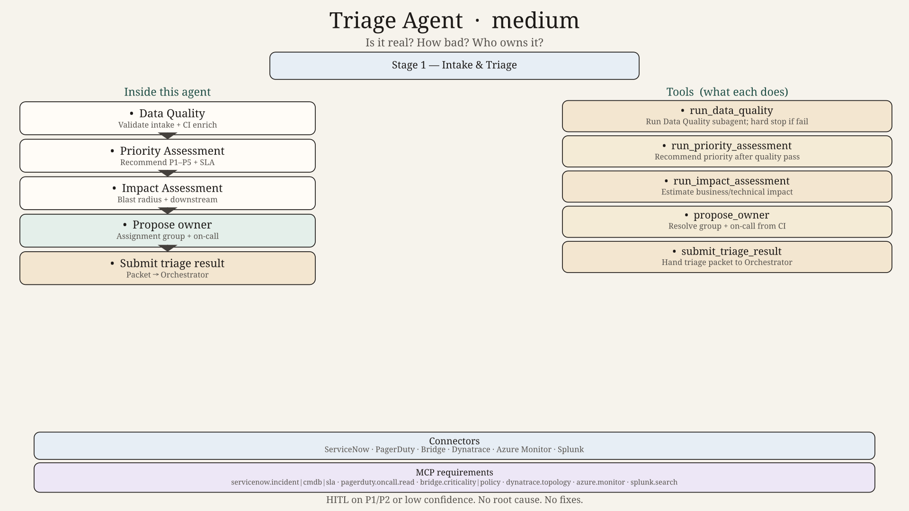
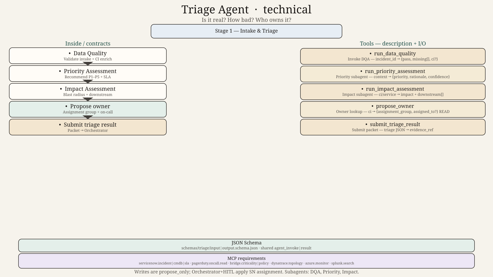

# Triage Agent — Design (detailed example)







## Plain role

The **Triage Agent** answers three questions only:

1. Is this a real, usable incident record?
2. How urgent is it (priority / severity)?
3. Who should own it right now?

It does **not** find root cause, run a fix, or close the ticket. Those belong to later stages.

## When the orchestrator calls you

- After a new ServiceNow incident or PagerDuty page lands.
- When intake fields changed and triage must be re-run.
- When a human asks “what priority should this be?”

## Subagents

| Subagent | One sentence |
|----------|--------------|
| **Data Quality Agent** | Make sure the ServiceNow record has the fields and CI context needed to triage. |
| **Priority Assessment Agent** | Recommend P1–P5 using severity, service criticality, and SLA policy. |
| **Impact Assessment Agent** | Estimate business and technical blast radius from service maps and user signals. |

Flow inside Triage:

```
Data Quality → (if pass) Priority + Impact → propose owner → submit triage result
```

If Data Quality fails, stop. Ask Communication / Orchestrator for missing context. Do not invent a CI or priority.

## Tools (parent)

| Tool | Purpose |
|------|---------|
| `run_data_quality` | Invoke Data Quality subagent |
| `run_priority_assessment` | Invoke Priority subagent |
| `run_impact_assessment` | Invoke Impact subagent |
| `propose_owner` | Resolve assignment group + on-call from CI / service |
| `submit_triage_result` | Hand priority, impact, owner, and notes back to Orchestrator |

## Connectors used (not agents)

- ServiceNow: get/update incident, CI, assignment group
- PagerDuty: on-call lookup
- Cognitive Bridge / CMDB: service criticality
- Dynatrace / Azure Monitor (read-only signals for impact — via Impact subagent connectors)

## HITL

Priority & Escalation gate fires when:

- recommended priority is P1/P2, or
- confidence < threshold, or
- Data Quality had to force-enrich disputed fields

## Output you must return

```yaml
incident_id: INC0xxxxx
data_quality: pass|fail
priority: P1|P2|P3|P4|P5
impact_summary: short text
assignment_group: name
assigned_to: user or null
confidence: 0.0-1.0
hitl_required: true|false
notes: []
```

## Why this is an agent (not a raw API)

APIs can fetch a CI and an SLA table. They cannot weigh conflicting signals (“APM says yellow, executives are calling, change window is open”) and produce a defendable priority + owner recommendation. That judgement is the agent’s job. The API calls stay as tools.

## Hard technical contracts

| Contract | Path |
|----------|------|
| Input payload | [`../../schemas/triage/input.schema.json`](../../schemas/triage/input.schema.json) |
| Output payload | [`../../schemas/triage/output.schema.json`](../../schemas/triage/output.schema.json) |
| Invoke/result wrappers | [`../../schemas/shared/`](../../schemas/shared/) |
| Ladder | 0=`diagram.png` → 50=`diagram_medium.png` → 100=`diagram_technical.png` + schemas |
