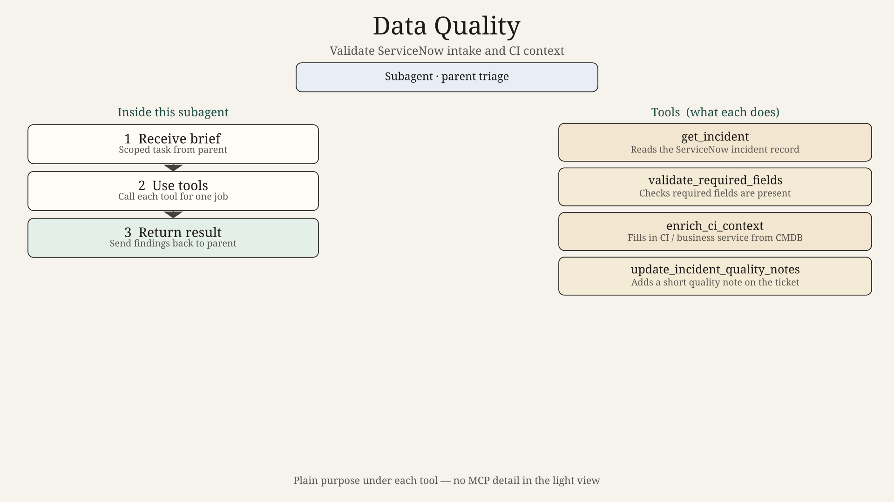
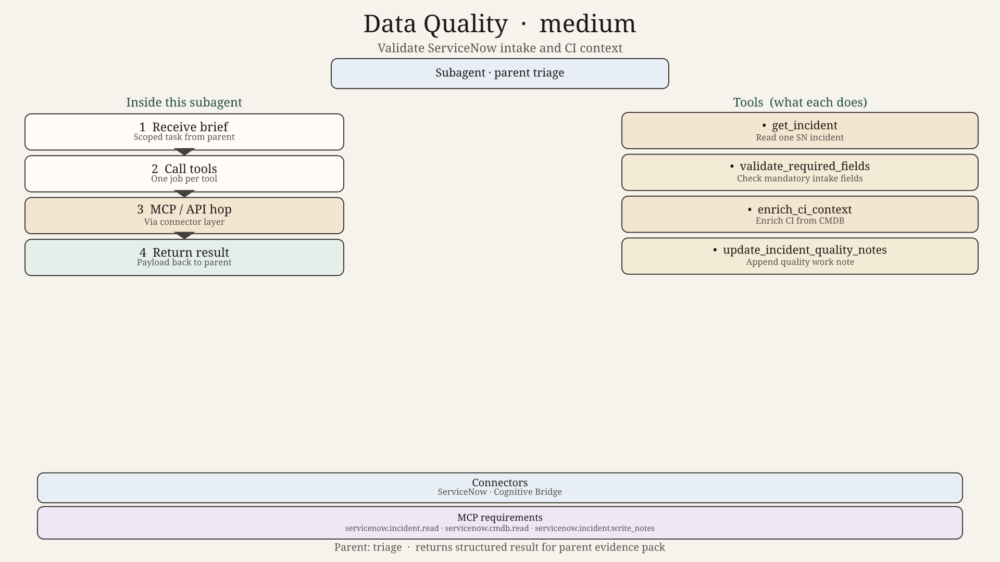
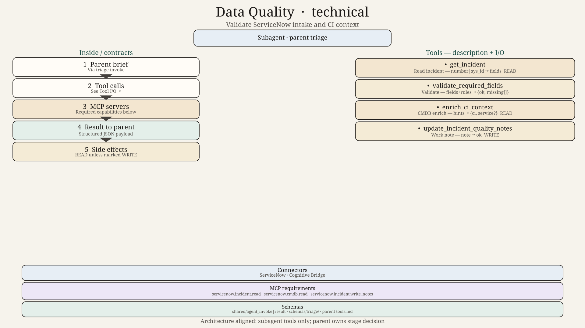

# Data Quality Agent — Design

## Role

Validate that the ServiceNow incident has enough correct context to triage. Fix nothing silently. Report gaps.

## Checks

- Number, short description, caller, opened time present
- CI or business service present (or enrichable)
- Category / subcategory sensible
- Duplicate / reopen hints noted, not auto-merged

## Tools

`get_incident`, `validate_required_fields`, `enrich_ci_context`, `update_incident_quality_notes`
