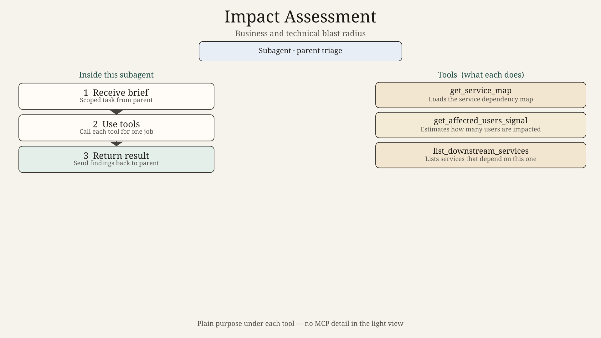
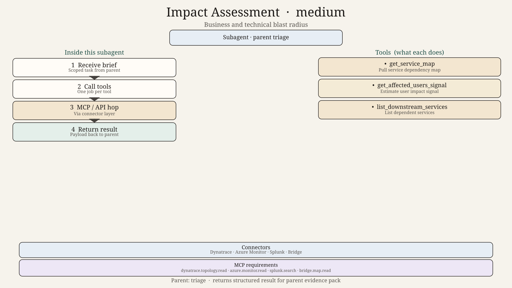
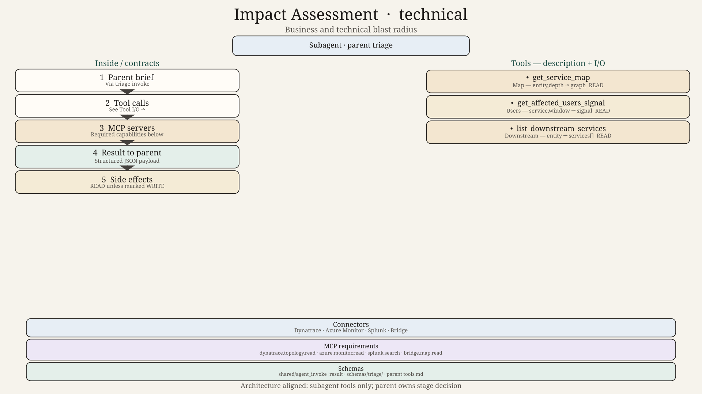

# Impact Assessment Agent — Design

## Role

Estimate business and technical blast radius: who is hurt, which services sit downstream, how wide it looks from monitoring signals.

## Tools

`get_service_map`, `get_affected_users_signal`, `list_downstream_services`
