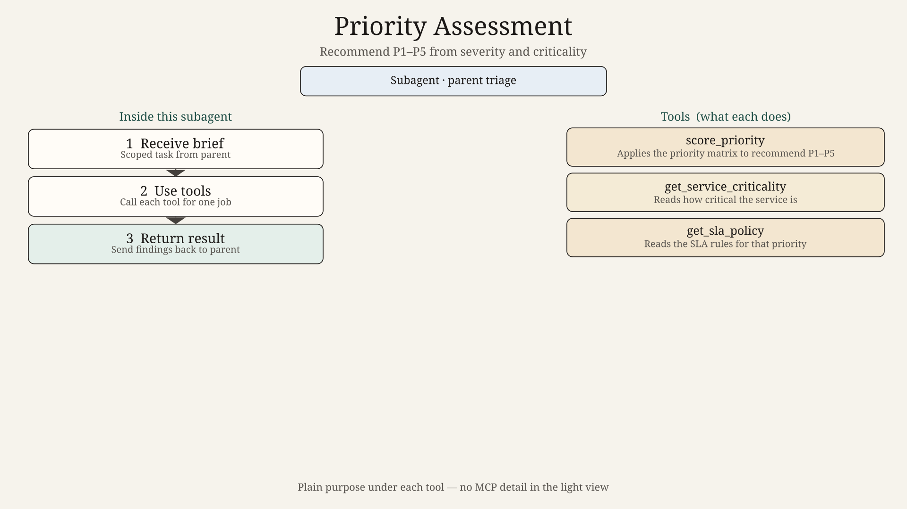
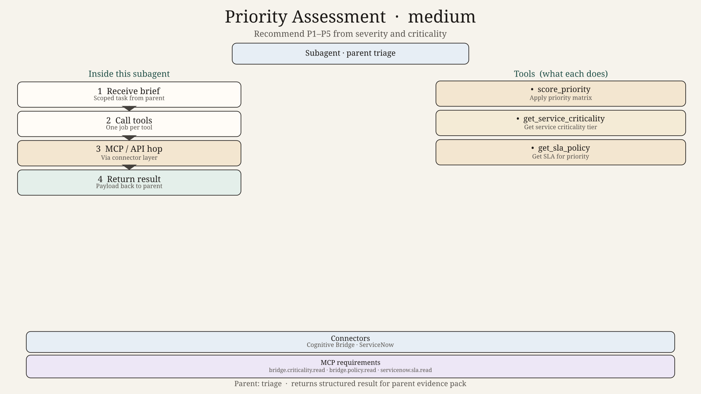
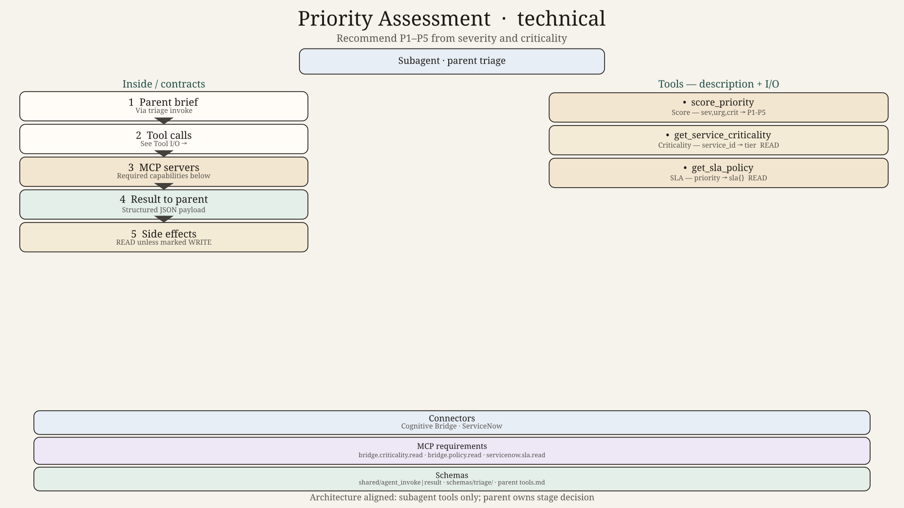

# Priority Assessment Agent — Design

## Role

Recommend incident priority (P1–P5) using severity signals, service criticality, and SLA policy.

## Inputs

- Incident severity / urgency fields
- Service criticality from Cognitive Bridge
- Active user or executive impact hints from Impact (if already available)

## Tools

`score_priority`, `get_service_criticality`, `get_sla_policy`
