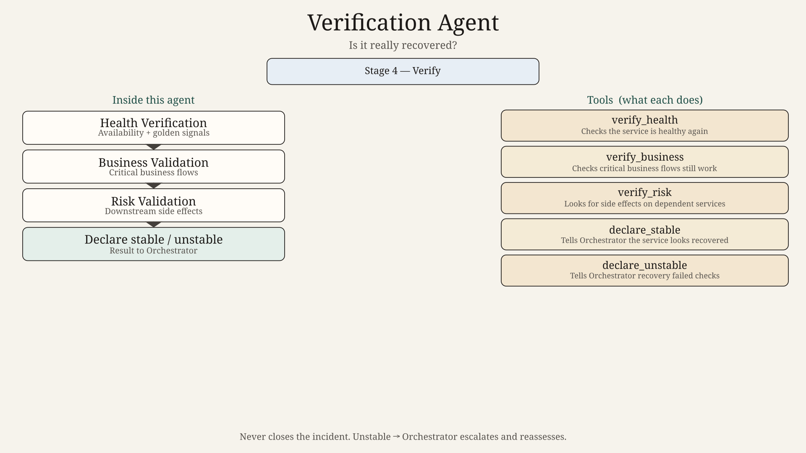
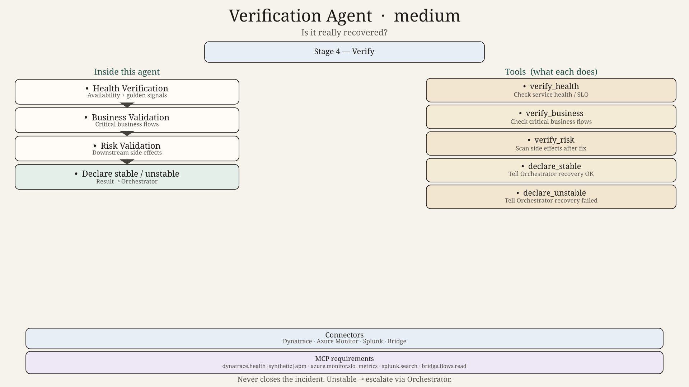
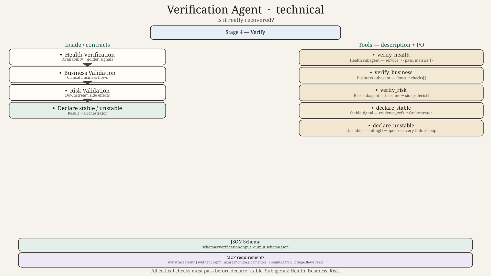

# Verification Agent — Design

## Role
Confirm the service is truly stable after recovery — health, business flows, and side-effect risk.

## Subagents
| Subagent | Job |
|----------|-----|
| Health Verification | Availability and golden signals |
| Business Validation | Critical business flows |
| Risk Validation | Downstream side effects |

## Parent tools
`verify_health`, `verify_business`, `verify_risk`, `declare_stable`, `declare_unstable`

## Hard technical contracts

| Contract | Path |
|----------|------|
| Input payload | [`../../schemas/verification/input.schema.json`](../../schemas/verification/input.schema.json) |
| Output payload | [`../../schemas/verification/output.schema.json`](../../schemas/verification/output.schema.json) |
| Invoke/result wrappers | [`../../schemas/shared/`](../../schemas/shared/) |
| Ladder | 0=`diagram.png` → 50=`diagram_medium.png` → 100=`diagram_technical.png` + schemas |
